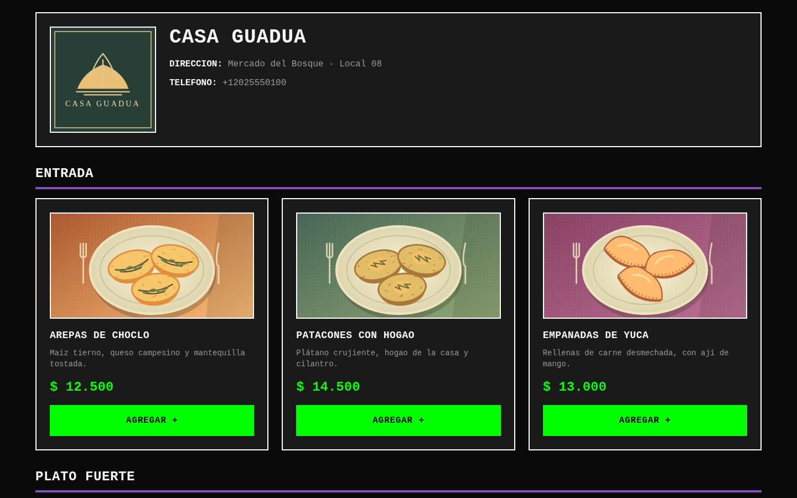
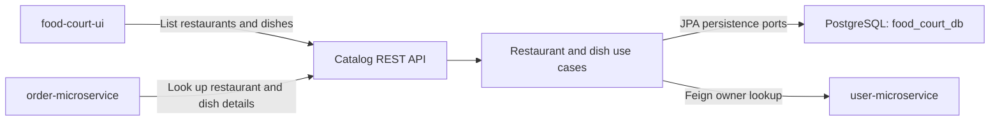

<!-- markdownlint-disable-next-line MD041 -->
<div align="center">

<h1>Food Court — Catalog API</h1>

<p><strong>One menu for restaurant owners, customers, and the service that checks each order.</strong></p>

<p>
<a href="https://github.com/diegnghtmr/food-court-microservice/actions/workflows/ci.yml"></a>


<a href="LICENSE"></a>
</p>

<p>
<a href="https://diegnghtmr.me/en/work/food-court/"><strong>Case study</strong></a> &bull;
<a href="#quick-start"><strong>Quick start</strong></a> &bull;
<a href="#architecture"><strong>Architecture</strong></a> &bull;
<a href="https://github.com/diegnghtmr/food-court-ui"><strong>Web app</strong></a>
</p>

</div>

<p align="center"></p>

*The Food Court web app uses this API to load the available dishes for a restaurant.*

A dish can be listed on the menu one hour and unavailable the next. This service stores restaurants, categories, dishes, and availability, so the browser can display the menu and the Order API can check what the customer selected. Owners can update their own dishes without deleting items that are temporarily unavailable.

## Features

- **Restaurant records.** Register restaurants with an owner reference and expose them through list and detail endpoints.
- **Categorized dishes.** Store menu items with a category, price, description, and image URL.
- **Menu browsing.** List dishes by restaurant for the web app and expose item details for order validation.
- **Availability controls.** Owners can change the active status of their own dishes without deleting them.
- **Owner checks.** Restaurant creation uses the Identity API to look up an owner, and dish changes check the caller’s ownership.

## Quick start

Install JDK 25 and Docker with Compose. Start the database container and run Spring on the host, where the checked-in API URLs point. The Gradle wrapper supplies Gradle 9.2.1.

```sh
git clone https://github.com/diegnghtmr/food-court-microservice.git
cd food-court-microservice
docker compose up -d foodcourt-postgres
./gradlew bootRun
```

API: `http://localhost:8091/foodcourt-api`. Open [Swagger UI](http://localhost:8091/foodcourt-api/swagger-ui.html) to inspect `/restaurants` and `/dishes`.

Start [Identity](https://github.com/diegnghtmr/user-microservice#quick-start) to issue tokens for authenticated requests. The registration lookup does not match the Identity API’s route; the case study uses a seeded restaurant to demonstrate menu browsing and checkout. See the [endpoint reference](docs/reference.md#api-endpoints) for the route mismatch and the [database settings](docs/reference.md#data-store-and-environment) for overrides.

## Architecture

Spring MVC controllers call application handlers and domain use cases. The domain owns menu and ownership rules; adapters handle PostgreSQL and the Feign owner lookup.



## Tech stack

| Layer | Technology |
| --- | --- |
| HTTP and security | Java 25, Spring Boot 4.0, Spring MVC, Spring Security, springdoc OpenAPI |
| Integrations | Spring Cloud OpenFeign, MapStruct |
| Persistence | Spring Data JPA, PostgreSQL 16 in the local stack |
| Build and tests | Gradle 9.2.1, JUnit Platform, H2 |

## Testing

```sh
./gradlew build
```

[CI](.github/workflows/ci.yml) runs the build and tests on Temurin 25. Use `./gradlew test` for just the test task. The Spring context test uses the repository’s H2 profile rather than the local PostgreSQL container.

## Documentation

- [Catalog API reference](docs/reference.md) — REST endpoints, data store and environment, ports and adapters, and system diagrams.

## Related repositories

| Repository | Role |
| --- | --- |
| [food-court-ui](https://github.com/diegnghtmr/food-court-ui) | Customer menus and owner dish management |
| [user-microservice](https://github.com/diegnghtmr/user-microservice) | Accounts, roles, and owner lookup |
| [order-microservice](https://github.com/diegnghtmr/order-microservice) | Validates restaurant and dish references before taking an order |
| [traceability-microservice](https://github.com/diegnghtmr/traceability-microservice) | Order history and fulfillment reports |

## License

Released under the [MIT License](LICENSE).
